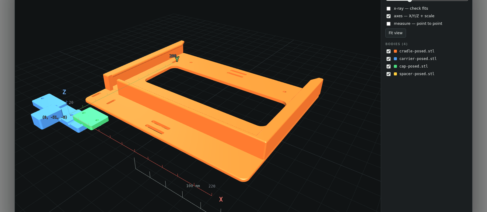
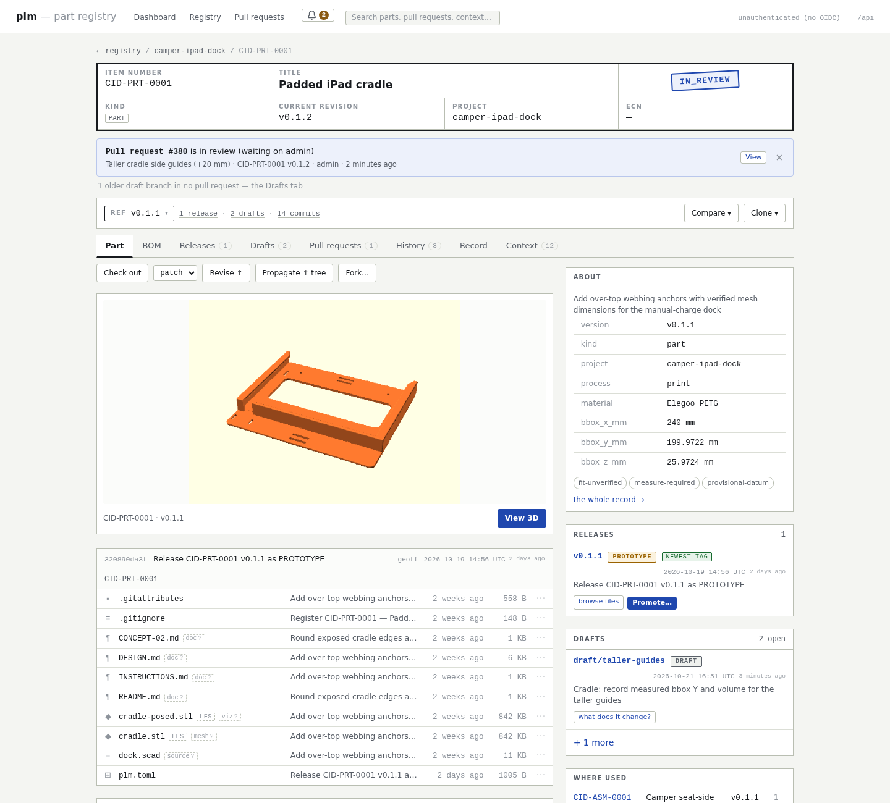
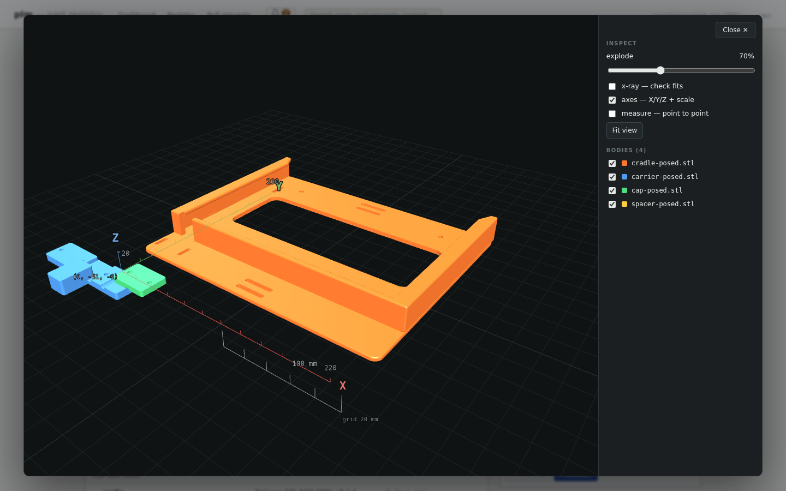
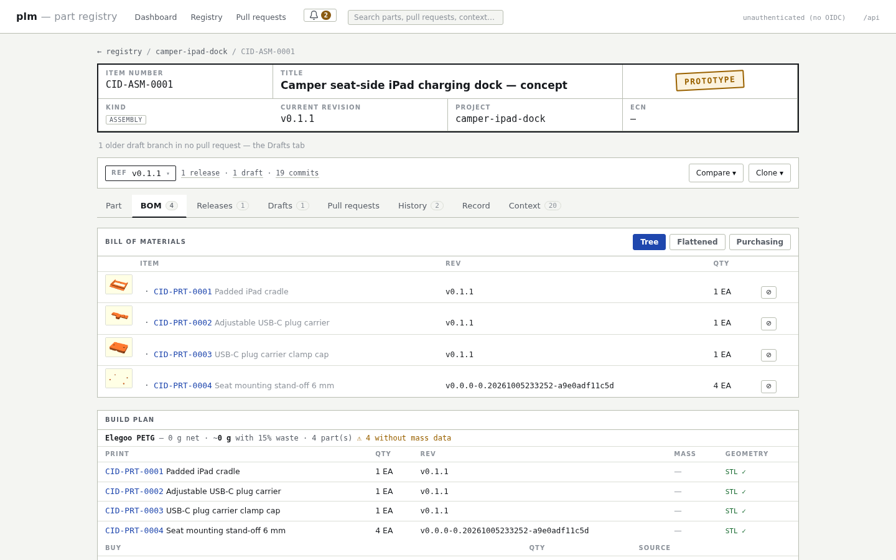
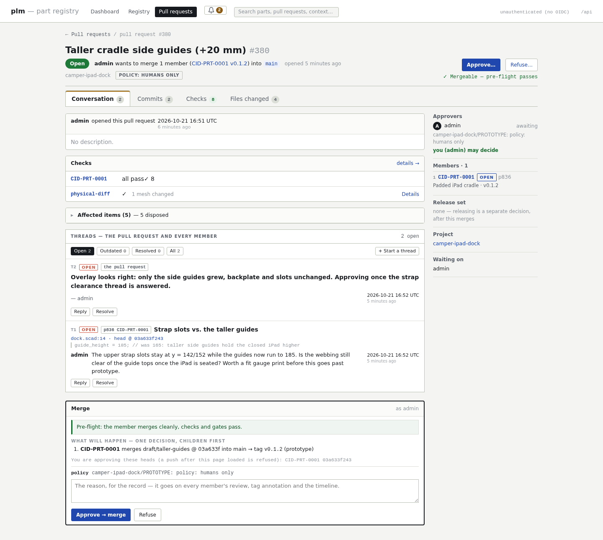
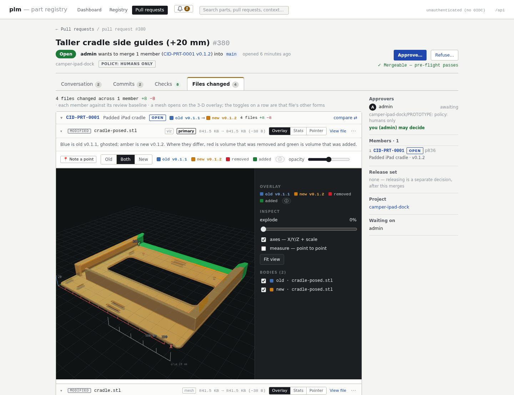
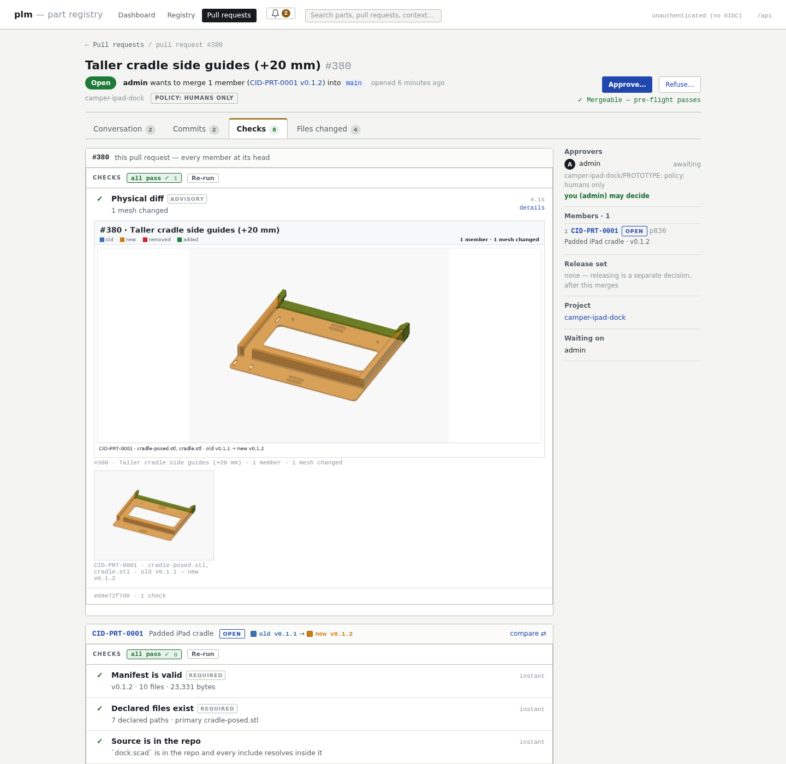
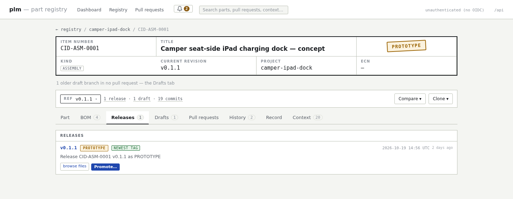
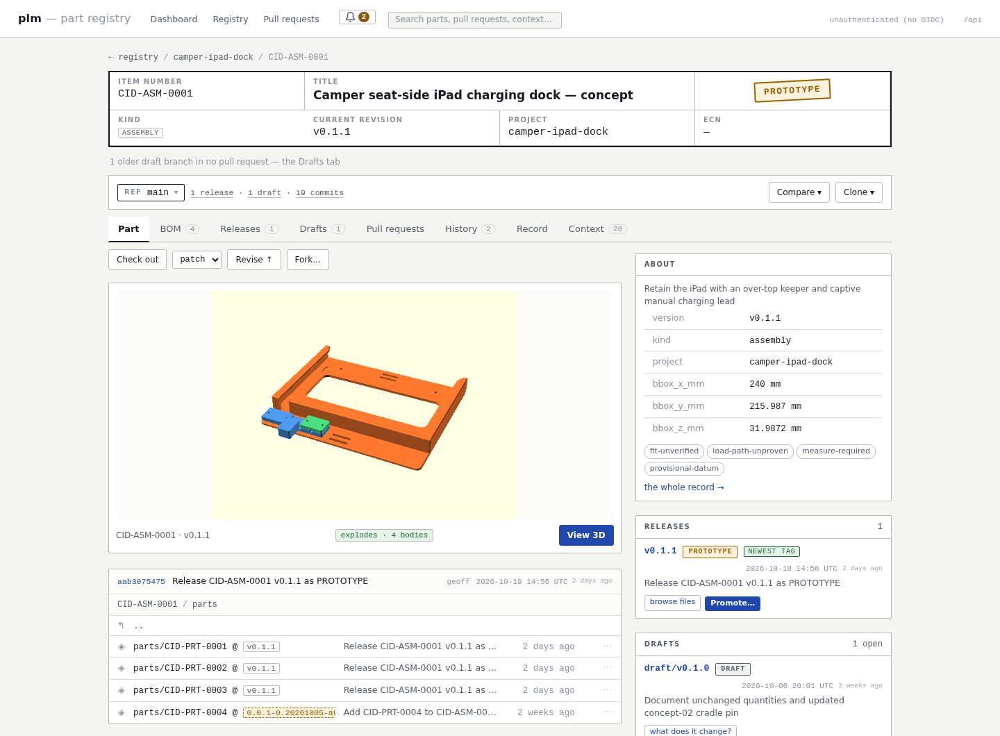
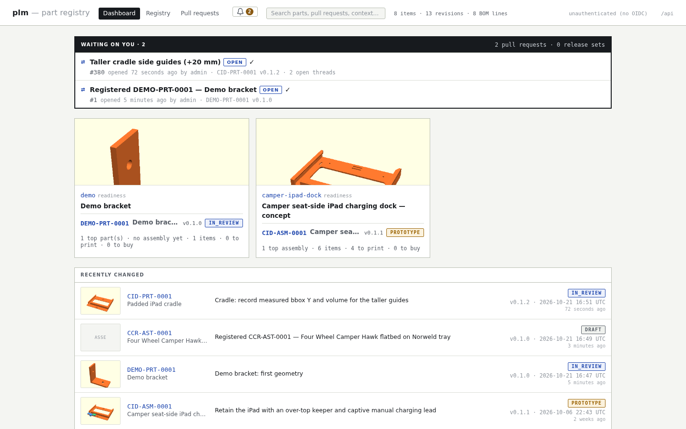

# plm

**GitHub for physical objects.** A product lifecycle manager for people who
build things, where every part is a git repository.

Developed with [Codex](https://openai.com/codex/).



## What it is

plm keeps track of the things you design and build: **parts, assemblies,
revisions, bills of materials, releases and the review that gets a change
from an idea to something you can print, cut or order.**

Underneath, every item **is a real git repository**:

- a **release** is an annotated tag (`v0.4.1`), immutable, carrying the approver and the release notes;
- a **draft** is a branch (`draft/…`), and you can have several at once;
- a **BOM child** is a git submodule, so the gitlink is the pinned revision;
- **meshes** (STL, 3MF, STEP, …) are Git LFS objects, served by plm itself;
- the part's metadata lives in a `plm.toml` next to the CAD: number, kind, source recipe, file roles, attributes, BOM lines and relations.

`git push` is a **proposal**. A person approving the pull request is the
merge: plm fast-forwards `main` (released work only), writes the tag, and
records who said yes.

On top of the repositories, plm adds what git doesn't have: a web UI with a 3D
viewer, BOM and build plan, pull requests with a *physical* diff, checks that
re-render OpenSCAD sources and measure the result, an HTTP API, and an MCP
server so that agents can do the legwork.

## Run it

Nothing is needed before this: no account, no hostname, no other service.
Docker (with the compose plugin) and git, on a laptop or a server.

```sh
git clone https://github.com/bruinlax/git-plm.git && cd git-plm
docker compose up -d --build        # ~5 min the first time (Ubuntu + OpenSCAD)
```

Open **http://localhost:8097**. Three services came up from one image:

| service | default address | what |
|---|---|---|
| `plm` | http://localhost:8097 | web UI + HTTP API |
| `plm-mcp` | http://localhost:8098/mcp | MCP server for agents |
| `plm-git` | http://localhost:8092/git/`<N>`.git | clone a part; `git push` = a proposal |

The first `up` made `./data/` (everything plm keeps, gitignored) and your
token, user `admin`:

```sh
export PLM_TOKEN=$(grep -v '^#' data/secrets/push-tokens | head -1 | cut -d= -f1)
# if that file is not yours to read (Linux, uid other than 1000):
export PLM_TOKEN=$(docker compose exec -T plm sh -c 'grep -v "^#" /run/secrets/push-tokens | head -1 | cut -d= -f1')
```

Load the sample project (the one in the screenshots below: six items, two
releases, an open pull request to approve), or create a first item:

```sh
scripts/load-example.sh          # examples/README.md says what arrives
```

```sh
curl -s -X POST http://localhost:8097/api/items \
  -H "Authorization: Bearer $PLM_TOKEN" -H 'Content-Type: application/json' \
  -d '{"name":"Demo bracket","kind":"part","project":"demo","prefix":"DEMO"}'
```

**A port already taken?** Pick others in a `.env` next to the compose file
and run `docker compose up -d` again; every link plm prints follows them:

```sh
cat > .env <<'END'
PLM_PORT=9097        # web UI + API      (default 8097)
PLM_MCP_PORT=9098    # MCP               (default 8098)
PLM_GIT_PORT=9092    # git clone / push  (default 8092)
END
```

Ports bind to `127.0.0.1`. To put plm on a hostname, open it to a network,
name the admin, or (on Linux) run as a uid other than 1000, start from
`sample.env` (copy it to `.env`): every line is optional and commented.
**[DEPLOY.md](DEPLOY.md)** walks through the first push, agents, auth modes,
more users, backups and upgrades.

## Why

The big PLM systems (Teamcenter and its peers) got the concepts right: items
and revisions, precise and imprecise BOM occurrences, change orders with
impact analysis, release status, signoffs. They are also too heavy for a
workshop, a small hardware team, or a single maker.

Git forges got the ergonomics right: pull requests, reviews bound to an exact
commit, line comments, status checks, tags and releases. But they know
nothing about product structure.

plm takes the PLM concepts and gives them the forge's shape:

- **Workshop scale.** One container image, SQLite, no external services. Your parts are plain git repositories you can clone, diff and mirror anywhere.
- **Agents as first-class users.** Most of the work (rendering, measuring, revising, filling in BOMs, drafting dispositions) is done by LLM agents through the MCP server or by `git push`. Every write is attributed to the agent's own token.
- **Humans approve.** A push is never a release. Who may approve, at which maturity, is a policy, and the record always says whether a human looked.

## A tour

### Items and the 3D viewer



An item page is a repository home with a drawing title block: the current
revision and its lifecycle stamp, the files at the selected ref (each with its
role: source, mesh, viz, doc), releases, open drafts, where-used and related
items. **View 3D** opens the mesh in a WebGL viewer with axes, measuring and
x-ray. Every file is browsable at any tag, branch or commit.

### Assemblies and the BOM



An assembly's children are submodules pinned to a revision, and each child
carries a *posed* mesh in the assembly's coordinates, so the viewer composes
and explodes the real assembly. plm checks that an assembly actually explodes
and won't release one that doesn't (unless someone records why).



The BOM tab shows the tree, the flattened list and a purchasing view, and the
build plan below it answers "what do I print, what do I buy, how much
filament". A purchase requirement nobody has chosen a part for yet stays
visible as exactly that, rather than as a fake catalogue item.

### Pull requests



A pull request groups one or more proposals, across one or more items, into one decision.
The conversation shows the checks, the affected items (parents that pin what
changed, other items sharing a changed source file) with their dispositions,
threads anchored to a line, a `plm.toml` key or a point on a mesh, and the
merge box with a pre-flight of exactly what approval will do.



**Files changed** diffs sources line by line, `plm.toml` field by field,
and meshes in 3D: the **overlay** puts the old revision (blue) and the new one
(amber) in the same frame, and paints volume that was removed red and volume
that was added green. Here the cradle's side guides grew 20 mm.



**Checks** run on every push: manifest and file presence, sources resolve
inside the repo, the mesh matches what its source renders to, measured bounding box,
volume and mass against the declared attributes, shared sources agree. The
pull request's own `physical-diff` check renders old against new for every
changed mesh, so a reviewer sees the physical change without opening anything.

### Releases



Releases are tags with notes. A release can be *promoted* later
(prototype → released) without touching the design: promotion is its own
small workflow with signoffs, a checklist and evidence, bound to the tag's
commit.

### The git door



Everything above is also plain git:

```sh
git clone --recurse-submodules http://localhost:8092/git/DEMO-PRT-0001.git
git tag                        # the releases
git branch -r                  # the drafts
git diff v0.1.0 v0.1.1         # the design change, nothing else
```

Push to a draft branch (or `refs/for/main`) with a bearer token and the push
output tells you what plm indexed, which checks ran, and the URL of the pull
request it opened.



## Working with agents

Any MCP client that speaks streamable HTTP can connect:

```json
{
  "mcpServers": {
    "plm": {
      "type": "http",
      "url": "http://localhost:8098/mcp",
      "headers": {"Authorization": "Bearer <token>"}
    }
  }
}
```

Give each agent its own token line and user: every write is recorded as the
token's actor, whatever a commit's author line says. The server's
instructions teach the agent the loop. The tools that matter most:

- **`whoami`** comes first. It answers who the token proves you are, and the project's git mode, and tells the agent to stop if the answer is not itself.
- **`get_item`, `search`, `get_bom`, `what_changed`** read. For most reading, the agent clones the repo and uses git.
- **`get_change` / `draft_dispositions`** show what a change affects and draft a decision for every affected item that isn't in it.
- **`submit_change`** waits for the checks, submits the pull request and asks a human once. Its answer leads with `say`, the one line the agent tells you ("Pull request #12 is waiting for your approval: …"), and then the agent stops.

## The model in one table

| PLM concept | In plm |
|---|---|
| item | a repository, `…/git/<NUMBER>.git` |
| revision | annotated tag `vX.Y.Z` on `main` |
| draft / work in progress | a branch `draft/…` (several at once) |
| `main` | released work only; only plm writes it |
| item metadata | `plm.toml` at the repo root |
| BOM line | a submodule (the pin) + a `[[bom]]` line (qty, find no.) |
| imprecise BOM line | `track = "release"`: a bump is proposed when the child releases |
| purchased / hardware item | a TOML file in a catalog submodule |
| large binaries (meshes, scans) | Git LFS, stored by plm |
| submit for review | `git push` to `draft/…` or `refs/for/main` |
| change order (ECO) | a pull request: N proposals across repos, decided together |
| approval | the merge: tag written, approver recorded in the annotation |
| release status, promotion | a release object on an existing tag; mirrored to `refs/notes/plm` |
| work instructions | `INSTRUCTIONS.md`, versioned with the part |
| "why" | commit messages, pull request descriptions, threads |

The design behind each row is in [docs/PLM_GIT_FIRST.md](docs/PLM_GIT_FIRST.md)
and [docs/PLM_REVIEW_MODEL.md](docs/PLM_REVIEW_MODEL.md).

## Status

- **Used daily by its author**, on one instance, with one human approver and several agents.
- **SQLite** for the database (the repositories and the LFS store are plain files). Fine for a workshop; not built for many concurrent writers.
- **Auth**: by default the network is the boundary (`trusted-network`: bind to localhost or a private network). Set `PLM_AUTH_MODE=required` and an OIDC provider for anything other people can reach.
- **Backups are your job.** Everything lives in `./data`; DEPLOY.md says how to copy it safely.
- **The API and the MCP tools may change** without notice. The git layout (tags, branches, submodules, `plm.toml`) is the most stable part.
- OpenSCAD is the only CAD that plm renders and checks itself. Other formats (STEP, Fusion exports, plain STL) are stored, versioned, viewed and diffed, but not regenerated.

## Repository layout

```
plm/          the server: HTTP API, git indexing, checks, pull requests, releases
plm_mcp/      the MCP server (agent tools + their instructions)
plm-git/      the git door: smart HTTP, the push hooks, the LFS batch API
web/          the UI: plain JavaScript + vendored three.js, no build step
docs/         design notes, one file per concept (start with PLM_GIT_FIRST.md)
deploy/       an alternative image build (not needed to run plm)
scripts/      load-example.sh
tests/        pytest suite
```

Run the tests with `uv run --python 3.12 --with pytest pytest tests -q`.

## Docs

- [DEPLOY.md](DEPLOY.md): install, first item, push, MCP, auth, backups, upgrades
- [docs/PLM_GIT_FIRST.md](docs/PLM_GIT_FIRST.md): every item is a git repo, and the manifest
- [docs/PLM_REVIEW_MODEL.md](docs/PLM_REVIEW_MODEL.md): pull requests, reviews, threads, releases
- [docs/PLM_DATA_MODEL.md](docs/PLM_DATA_MODEL.md): items, revisions, BOMs, numbering, attributes
- [docs/LARGE-FILES.md](docs/LARGE-FILES.md): Git LFS and the object store
- [docs/PLM_RELATIONS.md](docs/PLM_RELATIONS.md): typed relations, coupons, assets
- [docs/PLM_IDENTITY.md](docs/PLM_IDENTITY.md): users, tokens, OIDC, approvals

## Author

Built by [Geoff Doempke](https://doempke.com) for his own hardware projects.
The sample project (`examples/camper-ipad-dock`) demonstrates parts, assemblies,
revision history and a pending design review. Its actor labels and links have
been normalized for this public example.

## License

[MIT](LICENSE)
